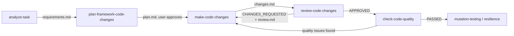

# AI Skills: Highly Available QE Platform

Model- and tool-agnostic skills for designing, implementing, reviewing, and auditing this repository's Highly Available QE Platform (Helm charts, Terraform, ArgoCD, JCasC, Kubernetes HA, LocalStack, and Monitoring). Each skill is defined in a standard `SKILL.md` with YAML front matter (`name`, `description`) and operates seamlessly across any LLM coding assistant (Antigravity CLI / agy, Claude Code, OpenAI Codex, etc.).

## Skills Overview

| Skill | Input | Output | Purpose |
|---|---|---|---|
| [`analyze-task`](analyze-task/SKILL.md) | Task description / ticket / prompt | `docs/requirements/<slug>-requirements.md` | Formalize requirements, scope, and HA criteria |
| [`plan-framework-code-changes`](plan-framework-code-changes/SKILL.md) | Requirements path + target layers | `docs/plans/<slug>-plan.md` | File-level implementation plan with architecture diagrams |
| [`make-code-changes`](make-code-changes/SKILL.md) | Approved plan path (+ review report in rework mode) | Working code + `docs/changes/<slug>-changes.md` | Implement infrastructure, Helm, ArgoCD, JCasC, and tests |
| [`review-code-changes`](review-code-changes/SKILL.md) | Change manifest path | `docs/reviews/<slug>-review-cycle-<n>.md` | 10-parameter HA, security, and idempotency review |
| [`check-code-quality`](check-code-quality/SKILL.md) | Manifest path or full scan | `docs/quality/<slug>-quality.md` | Linting & static analysis (Terraform, Helm, JCasC, Python, Shell) |
| [`scaffold-qe-module`](scaffold-qe-module/SKILL.md) | Component type, name, environment | Scaffolded component + manifest | Scaffold Terraform modules, Helm charts, JCasC, or pipelines |
| [`mutation-testing`](mutation-testing/SKILL.md) | Target HA workload / failure scenario | `docs/mutation/<slug>-mutation-report.md` | Injected fault & chaos testing (node drain, pod crash, alert triggers) |
| [`write-repo-learning-post`](write-repo-learning-post/SKILL.md) | Repository evidence | `docs/linkedin-posts/<slug>-post.txt` | LinkedIn learning post grounded in repo engineering decisions |

### Shared References

- [`_shared/framework-guidelines.md`](_shared/framework-guidelines.md): Repository blueprint, architectural rules, high availability standards, and verification commands.
- [`_shared/change-manifest-template.md`](_shared/change-manifest-template.md): Standard change manifest template produced by implementations and consumed by reviews.

## Platform Lifecycle Flow

## Conventions

- **Paths, Not Content**: Skills pass file paths between stages rather than inlining full documents into prompts.
- **Human In The Loop**: All plans require explicit approval before writing code.
- **Strict Evidence**: Reviews judge code based on concrete syntax, logs, and verifiable outcomes.
- **Zero Secrets**: Never commit tokens, credentials, or keys. LocalStack dummy credentials (`AWS_ACCESS_KEY_ID=test`) are standard for local emulation.
