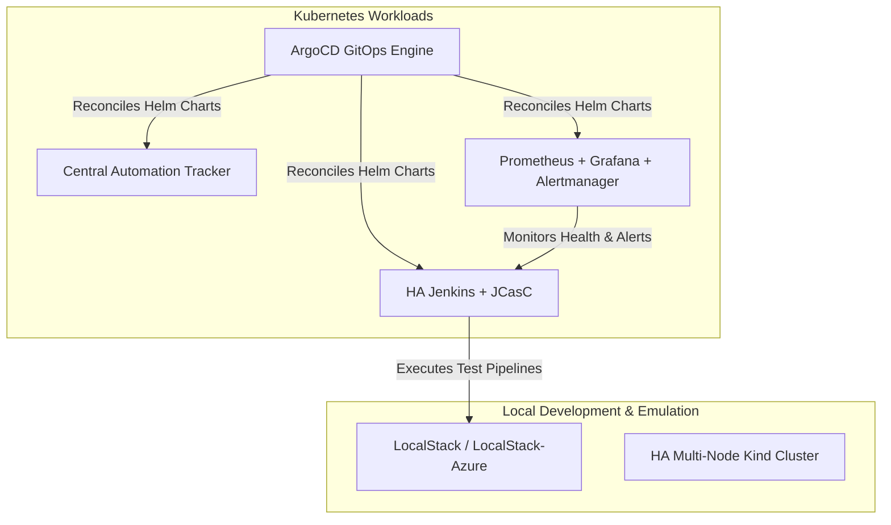
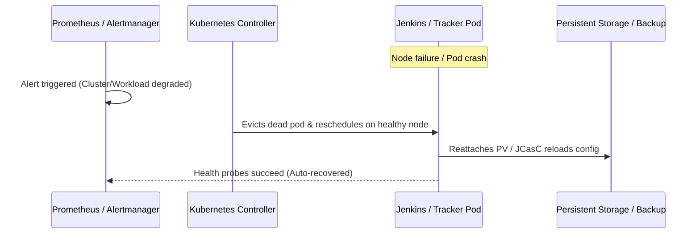

# plan-framework-code-changes

## Purpose

Produce `docs/plans/<slug>-plan.md`: a concrete, file-by-file implementation plan for the Highly Available QE Platform. The plan must be detailed enough that `make-code-changes` can execute it without making independent design choices.

## Inputs

| # | Question / Input | Required |
|---|---|---|
| 1 | Target layers: Terraform, Helm charts, Kubernetes/Kind, ArgoCD, Jenkins JCasC, Monitoring, Cloud Emulators, or Tests? | yes |
| 2 | Target environments: Local (Docker/Kind/LocalStack), AWS, and/or Azure? | yes |
| 3 | Requirements doc path (`docs/requirements/<slug>-requirements.md`) | recommended |
| 4 | Any specific HA constraints (RTO/RPO targets, replica counts, storage class, backup schedule)? | optional |

## Procedure

### 1. Load Context
- `.ai/skills/_shared/framework-guidelines.md`
- `requirements.txt` and `docs/requirements/<slug>-requirements.md` (if available)
- Read existing implementations under target paths before designing new files.

### 2. Survey Existing Assets & Reuse Opportunities
- Inspect existing Terraform modules (`terraform/modules/`), Helm charts (`kubernetes/helm/`), Kind configurations (`kubernetes/kind/`), and JCasC YAMLs (`jenkins/casc/`).
- Identify reusable modules (e.g., networking, storage, monitoring) rather than duplicating infrastructure declarations.
- Check LocalStack configuration (`cloud-emulators/aws/localstack/docker-compose.yml`) to ensure local emulation compatibility.

### 3. Architecture & High Availability Design
- Design for failure: Every critical service (Kubernetes control plane, Jenkins controller, Automation Tracker, Prometheus/Alertmanager) must have a redundancy or auto-recovery strategy.
- Detail PodDisruptionBudgets, liveness/readiness probes, volume snapshotting, and multi-AZ or multi-node scheduling rules.
- Design GitOps flow in ArgoCD for automated reconciliation.

### 4. Coverage & Verification Matrix
Specify how each functional and non-functional requirement will be proven:
- Linters: `terraform fmt`, `terraform validate`, `tflint`, `helm lint`, `kubeconform`, `yamllint`.
- Integration tests: `pytest tests/aws-integration/`, `pytest tests/azure-integration/`.
- Resilience / Failover tests: `pytest tests/kubernetes-ha/`, `pytest tests/failover/`, `pytest tests/disaster-recovery/`.

### 5. Detailed File-Level Specification
For every file to be created or modified, specify:
- File path
- Action (`Added`, `Modified`, `Deleted`)
- Purpose and specific changes (parameters, resources, manifests)
- Layer

### 6. Write Plan & Human Approval Gate
- Write `docs/plans/<slug>-plan.md` using the template below.
- Include Mermaid architecture and failover sequence diagrams.
- Present a concise summary to the user and request approval before coding begins.

## Output Template: `docs/plans/<slug>-plan.md`

```markdown
# Implementation Plan: <title>

| Field | Value |
|---|---|
| Slug | `<slug>` |
| Requirements | `<path or n/a>` |
| Status | Proposed / Approved (<YYYY-MM-DD>) |
| Target Environments | Local (Docker/Kind/LocalStack) / AWS / Azure |

## 1. Architecture Overview & High Availability Strategy
<Summary of how the components interact and how high availability / failover is guaranteed.>

### Mermaid Architecture Diagram


### Failover & Resilience Flow


## 2. File Changes

| # | Path | Action | Layer | Description |
|---|---|---|---|---|
| 1 | `terraform/modules/kubernetes/main.tf` | Added | terraform | HA cluster configuration |
| 2 | `kubernetes/helm/jenkins-ha/values.yaml` | Added | helm | Values with JCasC, PDB, health checks |
| 3 | `jenkins/casc/jenkins.yaml` | Added | jenkins-casc | Dynamic agent templates & security |

## 3. Detailed Component Designs

### 3.1 `<Path>`
- **Resources / Blocks**: ...
- **Configuration Variables**: ...
- **Resilience / Security Considerations**: ...

## 4. Verification & Testing Matrix

| Requirement ID | Verification Tool / Test Suite | Command | Expected Outcome |
|---|---|---|---|
| FR-1 | Terraform Validate | `terraform -chdir=... validate` | Success |
| FR-2 | Helm Lint | `helm lint kubernetes/helm/...` | Clean pass |
| NFR-1 | LocalStack Integration | `pytest tests/aws-integration/` | All pass |
| NFR-HA | Failover Test | `pytest tests/failover/` | Recovery < 60s |
```
