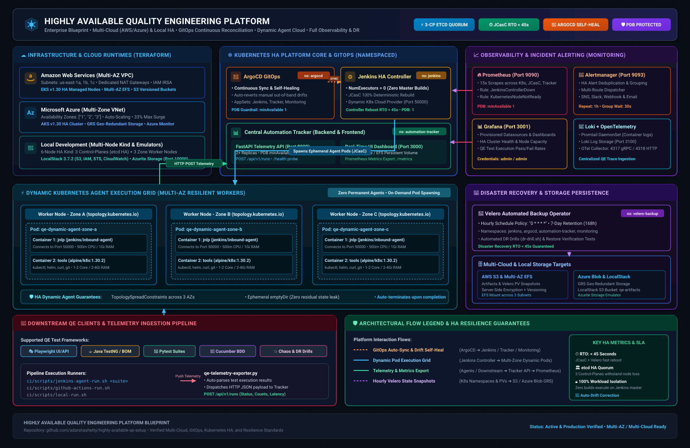
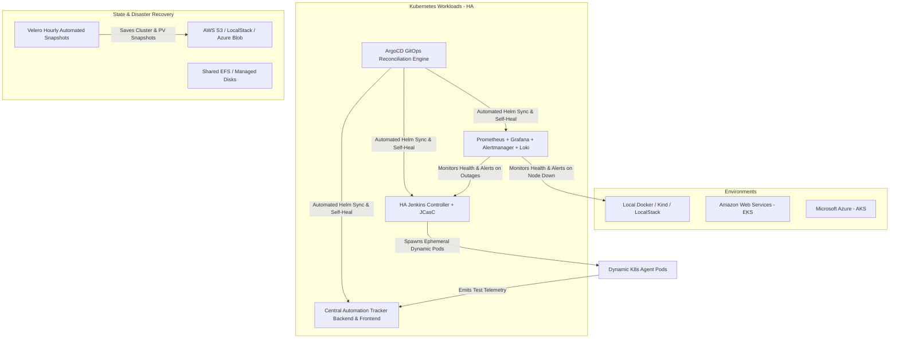

# Highly Available QE Platform

Production-ready, highly available Quality Engineering (QE) infrastructure supporting **AWS**, **Microsoft Azure**, and **Local Docker / Kind / LocalStack**.

Built with **Terraform**, **Helm Charts**, **ArgoCD**, **Jenkins Configuration as Code (JCasC)**, and a **Full Observability Stack**.

---

## 🏗️ Architecture Blueprint





---

## 📁 Repository Structure

```
highly-available-qa/
│
├── environments/               # Environment-level orchestration & deployment scripts
│   ├── local/                  # Local docker-compose, .env, setup script, Makefile
│   ├── aws/                    # AWS tfvars example & deployment script
│   └── azure/                  # Azure tfvars example & deployment script
│
├── cloud-emulators/            # Offline cloud emulation runtimes
│   ├── aws/localstack/         # LocalStack docker-compose & S3/SNS/SQS init scripts
│   └── azure/localstack-azure/ # Azurite local Azure storage emulator & init scripts
│
├── terraform/                  # Infrastructure as Code
│   ├── modules/                # Reusable modules
│   │   ├── kubernetes/         # EKS cluster, managed node groups, OIDC IRSA
│   │   ├── networking/         # Multi-AZ VPC, subnets, NAT gateways, route tables
│   │   ├── storage/            # S3 buckets, EFS file systems, versioning, lifecycles
│   │   ├── iam/                # IAM roles, policies, service account federation
│   │   └── monitoring/         # CloudWatch log groups & metric alarms
│   ├── aws/                    # AWS root module (supports LocalStack toggle)
│   └── azure/                  # Azure root module (AKS, VNet, Storage Account)
│
├── kubernetes/                 # Kubernetes manifests, Kind configs & Helm charts
│   ├── kind/                   # Multi-node HA Kind cluster (3 Control Plane + 3 Workers)
│   ├── namespaces/             # Namespaces (jenkins, argocd, monitoring, tracker)
│   ├── policies/               # PodDisruptionBudgets (PDB) & NetworkPolicies
│   ├── helm/
│   │   ├── jenkins-ha/         # Custom HA Jenkins Helm chart with JCasC & PDB
│   │   └── qe-central-tracking-application/ # Central QE Tracking Helm chart (Backend + UI)
│   └── argocd/                 # ArgoCD Applications with automated drift self-healing
│
├── jenkins/                    # Jenkins CI/CD controller configuration
│   ├── casc/                   # JCasC YAML (Dynamic K8s cloud, agents, security)
│   ├── jobs/                   # Job DSL seed scripts
│   ├── plugins/                # Locked & pinned plugins.txt
│   └── pipelines/              # Declarative multi-stage pipelines
│
├── qe-central-tracking-application/ # Central QE tracking and analysis service
│   ├── backend/                # FastAPI telemetry & metrics API with Prometheus metrics
│   ├── frontend/               # Real-time multi-category tracking dashboard
│   └── tests/                  # API contract and integration tests
│
├── monitoring/                 # Full observability stack
│   ├── prometheus/             # Scrape configs & HA outage alerting rules
│   ├── grafana/                # Provisioned datasources & HA platform dashboard
│   ├── alertmanager/           # Alert routing, deduplication, and notifications
│   └── loki/                   # Centralized log aggregation & Promtail configs
│
├── backup-recovery/            # Business continuity & disaster recovery
│   ├── scripts/                # Automated backup, restore, and DR drill scripts
│   ├── policies/               # Velero hourly schedule policy with 7-day TTL
│   └── restore-tests/          # Automated restore validation tests
│
├── tests/                      # Validation test suites
│   ├── aws-integration/        # Tests against AWS / LocalStack
│   ├── azure-integration/      # Tests against Azure / Azurite
│   ├── kubernetes-ha/          # Multi-control-plane & node disruption tests
│   ├── failover/               # Jenkins controller crash & tracker recovery tests
│   └── disaster-recovery/      # Cold-start and state restoration verification
│
├── ci/                         # Downstream QE-base integration
│   ├── scripts/                # CI execution scripts (Jenkins agent, GitHub, local)
│   └── observability/          # OpenTelemetry config & telemetry exporter utility
│
└── .ai/                        # Model-agnostic AI agent pipeline & skills
```

---

## 🚀 Quick Start (Local Environment)

### Prerequisites
- Docker & Docker Compose
- Kind (Kubernetes in Docker)
- Terraform (>= 1.5.0)
- Python (>= 3.10) & Pytest

### 1. Launch the Local Platform
```bash
cd environments/local
make up
```
This single command spins up:
- **LocalStack AWS Gateway**: `http://localhost:4566`
- **Azurite Azure Emulator**: `http://localhost:10000`
- **Central QE Tracking Dashboard**: `http://localhost:3000`
- **QE Central Tracking API**: `http://localhost:8000/docs`
- **Prometheus Engine**: `http://localhost:9090`
- **Grafana Dashboards**: `http://localhost:3001` (Credentials: `admin`/`admin`)
- **Alertmanager**: `http://localhost:9093`

### 2. Multi-Node HA Kubernetes Cluster (Kind)
```bash
bash kubernetes/kind/setup-kind.sh
```
Provisions a 6-node cluster (3 control-plane nodes for etcd quorum + 3 worker nodes spanning logical availability zones).

---

## ☁️ Cloud Deployments

### AWS Deployment via Terraform
```bash
cd environments/aws
cp terraform.tfvars.example terraform.tfvars
bash deploy-aws.sh
```
- Multi-AZ VPC across 3 Availability Zones with dedicated public and private subnets.
- Highly Available Amazon EKS Cluster (version 1.30) with auto-repairing managed node groups.
- S3 buckets for artifacts and Velero backups with server-side encryption and versioning.
- Amazon EFS for multi-AZ persistent shared storage.
- CloudWatch alarms & SNS notifications for node or cluster degradation.

### Microsoft Azure Deployment via Terraform
```bash
cd environments/azure
cp terraform.tfvars.example terraform.tfvars
bash deploy-azure.sh
```
- Multi-AZ Virtual Network and Subnets.
- Azure Kubernetes Service (AKS) with availability zones `["1", "2", "3"]`, auto-scaling, and rolling max-surge upgrades.
- Geo-Redundant Azure Blob Storage (GRS) for disaster recovery backups.
- Azure Monitor Action Groups for instant alert delivery.

---

## 🔄 High Availability & Self-Healing Guarantees

1. **Kubernetes Multi-Control-Plane**: 3 control-plane nodes maintain etcd quorum during node disruptions.
2. **PodDisruptionBudgets (PDB)**: Configured across Jenkins, ArgoCD, and the Automation Tracker to prevent voluntary evictions from taking services offline.
3. **Jenkins Controller HA & JCasC**:
   - Zero builds run on the controller; all jobs execute in dynamic, auto-scaling Kubernetes worker pods.
   - JCasC (`jenkins/casc/jenkins.yaml`) enables full controller reconstitution in < 45 seconds upon container crash.
4. **GitOps with ArgoCD**:
   - Continuous synchronization and self-healing (`selfHeal: true`) immediately revert unauthorized out-of-band drifts.
5. **Observability & Outage Alerting**:
   - Prometheus continuously scrapes Jenkins health and cluster node states.
   - Immediate critical alerts (`JenkinsControllerDown`, `KubernetesNodeNotReady`) fire within 30 seconds to Alertmanager.

---

## 🧪 Running Verification & Resilience Tests

```bash
# Run all integration, HA failover, and disaster recovery suites
pytest tests/ -v

# Run specifically the chaos & failover verification suite
pytest tests/failover/ -v

# Run the automated disaster recovery drill
bash backup-recovery/scripts/dr-drill.sh
```

---

## 📡 Downstream QE-Base Observability Integration

To integrate any downstream `qe-base` repository (e.g., `qe-bom-base-java`, Playwright, or Cucumber frameworks):

1. **Dynamic Jenkins Agent Execution**:
   Run tests using `ci/scripts/jenkins-agent-run.sh <suite-name>`.
2. **GitHub Actions Execution**:
   Run tests using `ci/scripts/github-actions-run.sh`.
3. **Automatic Telemetry Ingestion**:
   Test execution outcomes, duration, and pass/fail counts are automatically pushed to the **Central Automation Tracker** and visualized in real time on the Grafana and Tracker dashboards.
